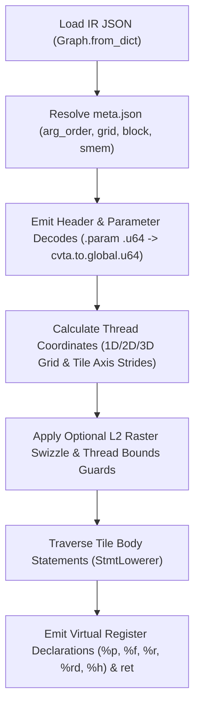

# Emmy Kernel IR to PTX Compiler Architecture (sm_89)

A standalone Python compiler that translates Emmy Kernel IR JSON ASTs directly into NVIDIA PTX assembly targeting `sm_89`.

---

## 1. Executive Summary & Submission Contract

The compiler satisfies the hackathon invocation contract:
```bash
python compile.py path/to/<kernel>.ir.json > out.ptx
```
- **Input**: Path to a Kernel IR JSON file (`sys.argv[1]`).
- **Output**: Valid PTX assembly printed directly to `stdout`.
- **Target Architecture**: `.target sm_89` (the hosted runner's NVIDIA driver JIT-compiles this PTX for the RTX 5090).

### Implementation Principles & Compliance
- The compiler does not call `render_kernelop`, `emmy compile`, `nvcc`, or any other compiler.
- Emmy is used exclusively to deserialize the input JSON AST into Python dataclasses (`Graph.from_dict`), as permitted by `TASK.md`.
- Semantics were derived from `TASK.md`, the shipped `.ir.txt` and `.ref.cu` reference files, and the official NVIDIA PTX ISA specification.

### Sources
- Emmy Kernel IR Specification and AST dataclasses (`TASK.md`, `emmy.compiler.ir`).
- Shipped problem references (`problems/*/*.ir.txt` and `problems/*/*.ref.cu`).
- NVIDIA PTX ISA: Parallel Thread Execution ISA Version 8.0.
- Threadblock rasterization logic derived from the reference CUDA (`.ref.cu`) of `a02_attention_128` and standard grouped 2D threadblock tiling.

---

## 2. Compiler Pipeline Architecture



The codebase is organized into four core modules:

| Module | Responsibility |
|---|---|
| `compile.py` | CLI entry point, metadata and shape extraction, grid decomposition, L2 raster swizzle, shared memory layout, and PTX header/epilogue synthesis. |
| `compiler/context.py` | Codegen context, virtual register banks (`%p`, `%f`, `%r`, `%rd`, `%h`), and centralized data type registry (`DTYPE_INFO`). |
| `compiler/expr.py` | Recursive AST expression evaluator, IEEE-754 float hex serialization, multi-dimensional index flattener, and type promotion (`as_f32`). |
| `compiler/stmts.py` | Statement lowerer (`Load`, `Write`, `Accum`, `Assign`, `StridedLoop`, `WarpShuffle`, `TreeHalve`, `CpAsyncCopy`), accumulator table (`ACCUM_OPS`), and shared memory addressing. |

---

## 3. Notable Design Decisions

### Loud Failure Over Silent Fallback
Unsupported constructs fail immediately with descriptive `NotImplementedError` or `TypeError` exceptions rather than emitting invalid PTX or silently corrupting memory. For example:
- Atomics on non-f32 buffers raise `NotImplementedError`.
- Float modulo `%` raises `TypeError`.
- Non-numeric `Init` identities raise `NotImplementedError`.
- Non-standard `Write` or `CpAsyncCopy` swizzle modes raise `NotImplementedError`.

### Single Consolidated Accumulator Table
Accumulator operations and identities are merged into a single table:
```python
ACCUM_OPS = {
    "add": ("add.f32", 0.0),
    "maximum": ("max.f32", -1e30),
    "minimum": ("min.f32", 1e30),
    "multiply": ("mul.f32", 1.0),
}
```
This guarantees accumulator operations and identities cannot drift apart, and unsupported operations fail fast.

### Dedicated 16-Bit Register Banking for `f16` and `bf16`
PTX instruction `cvt.rn.bf16.f32` strictly requires destination registers to be 16-bit (`.b16`). Storing into `.b32` registers causes `ptxas` argument mismatch rejections.
- Declared `.reg .b16 %h<N>` bank in `CodegenContext`.
- Both `f16` and `bf16` loads load into `%h` registers and convert to `f32` via `cvt.f32.f16` and `cvt.f32.bf16`.
- Both `f16` and `bf16` stores convert from `f32` into `%h` registers via `cvt.rn.f16.f32` and `cvt.rn.bf16.f32`, storing via `st.{space}.b16` (or `.v2.b16` / `.v4.b16`).

### Signed vs. Unsigned Integer Float Promotion
When integer-typed `Let` bindings feed floating-point expressions or accumulators, `as_f32()` distinguishes signed from unsigned types:
- `s32` -> `cvt.rn.f32.s32`
- `u32` -> `cvt.rn.f32.u32`
This ensures values above `2^31 - 1` are not treated as negative numbers under two's complement interpretation.

### Shared Memory Allocation
- When `desc.smem_bytes > 0`, the compiler emits `.extern .shared .align 16 .b8 _smem_pool[];` and partitions buffer offsets with 16-byte alignment.
- When `desc.smem_bytes == 0`, static `.shared .align <align> .b8 <name>[<bytes>];` buffers are allocated using `.align 16` if byte size is divisible by 16, and `.align 4` otherwise.
- Kernel IR shared memory offsets calculate 4-byte word strides via `shl.b32 byte_off, flat_idx, 2`.

---

## 4. Problem Category Coverage

| Category | Representative Kernel | Features Handled |
|---|---|---|
| **1. Pointwise** | `p00` to `p03` | Multi-cell unrolling, scalar & vector memory operations (`.v2`, `.v4`), constant scalar inputs, and bounds guarding. |
| **2. Reductions** | `r01` to `r04` | Strided loops, accumulator registers, warp shuffle butterfly ladders (`shfl.sync.bfly.b32`), shared memory staging, barriers, and multi-warp `TreeHalve` reduction trees. |
| **3. Matmul** | `m01`, `m02` | 2D tile indexing, outer loops, asynchronous shared memory staging (`cp.async.ca`, `cp.async.cg`, `commit_group`, `wait_group`), 2D register accumulator tiles, and split-K atomic additions (`red.global.add.f32` with `zero_outputs`). |
| **4. Fused** | `f01` to `f03` | Fused reduction and scaling passes (`rmsnorm`, `l2norm`), and online dual-accumulator softmax (`f02_row_softmax`) maintaining coupled running maximum and exponential sum. |
| **5. Attention-Like** | `a01`, `a02` | Fused GEMM and online softmax attention with continuous rescaling and vector value loads. |

---

## 5. Limitations and Assumptions

1. **Collective Kernel Launch Assumption**:
   Kernels with cross-thread communication (`WarpShuffle`, `TreeHalve`, `Sync`, `CpAsyncCopy`) are assumed to fit the launch geometry exactly (`cells == threads`), as confirmed by `tools/check_geometry.py` on the open benchmark set. Early exit bounds guards are emitted only on non-collective kernels to prevent skipping block-wide synchronization barriers.
2. **Unsupported Constructs**:
   The compiler explicitly raises `NotImplementedError` on:
   - `TreeHalve.inner` (segmented reduction).
   - Non-default swizzling on `Write` or `CpAsyncCopy` (`swizzle != "NONE"`).
   - Atomic writes on non-`f32` buffers.
   - 2D or 3D thread block configurations (`block` must be 1D `[bx, 1, 1]`; grids can be 1D, 2D, or 3D).
3. **Execution Validation Scope**:
   - The 15 open benchmark problems validate `f32` scalar and vector computation.
   - `f16`, `bf16`, mixed int/float promotion, and `minimum`/`multiply` accumulators were validated via synthetic kernels executed directly on the runner hardware.
   - Ragged-tail `Init` + `Select` paths are not exercised by the problem set.

---

## 6. Verification & Test Suite

### Official Benchmark Suite
All 15 problem suites pass through the test runner against `http://runner.riftstack.ai:48701`:
```bash
python submit.py <problem_name> --compiler compile.py
```
**Result**: 15/15 PASS.

### Modular Unit and Hardware Integration Suite
Run the 16 unit and integration tests:
```bash
python -m unittest discover tests -v
```
All 14 unit tests run entirely offline. The 2 remote integration tests in `test_integration.py` connect to the runner and skip cleanly if the runner is unreachable.

Test breakdown across `tests/`:
- `tests/test_cli.py` (3 tests): CLI contract invocation across Pointwise, Matmul, and Attention kernels.
- `tests/test_dtypes.py` (3 tests): Type resolution, register allocation, and signed/unsigned integer conversion.
- `tests/test_guards.py` (5 tests): Safety assertions for non-f32 atomics, invalid `Init` identities, float modulo, write swizzling, and `cp.async` copy widths.
- `tests/test_lowering.py` (3 tests): Vector loads/stores (`v2`, `v4`), accumulator promotion, and identity verification.
- `tests/test_integration.py` (2 tests): Remote runner compilation and execution on RTX 5090 hardware (`3,000,000,000` unsigned integer conversion).
