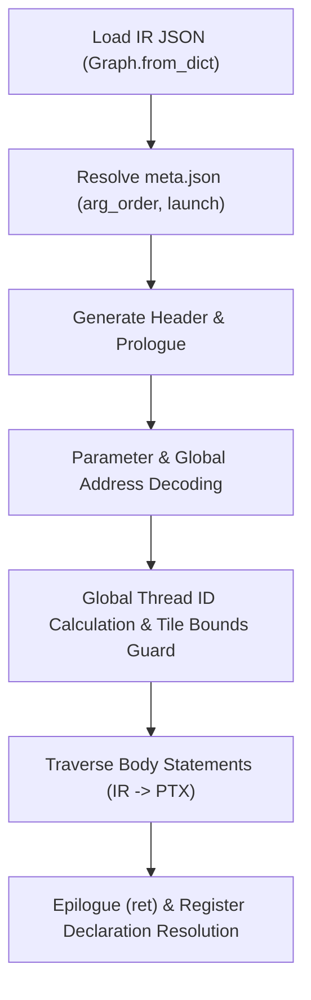

# Emmy Hackathon: Kernel IR to PTX Compiler Knowledge Base

## 1. Project Goal & Submission Contract

The objective is to implement a direct compiler from Emmy's Kernel IR to NVIDIA PTX assembly.
This replaces Emmy's default path (Kernel IR -> CUDA C++ -> nvcc) to achieve fast compilation using `ptxas`.

### CLI Contract
The compiler must be executable from the repository root via:
```bash
python compile.py path/to/<kernel>.ir.json > out.ptx
```
- Input: Absolute or relative path to a Kernel IR JSON file (`sys.argv[1]`).
- Output: Valid PTX assembly printed directly to `stdout`.
- Metadata resolution: Per-kernel parameter ordering (`arg_order`) and launch specifications must be read from the sibling `meta.json` in the same directory as the IR file (`ir_path.parent / "meta.json"`). If `meta.json` is absent, fallback to `node.inputs + node.outputs`.

### Prohibited Approaches
- Translating through Emmy's internal C++ renderer (`render_kernelop`).
- Calling `emmy compile`, `nvcc`, or any external C++/CUDA compiler.
- Loading the IR with Emmy's `Graph.from_dict` is permitted and required.

---

## 2. Target Platform & Runner Verification

### Target Architecture
- Header declarations:
  ```ptx
  .version 8.0
  .target sm_89
  .address_size 64
  ```
- Compatibility: PTX targeting `sm_89` executes transparently on the hosted runner's NVIDIA RTX 5090 (`sm_120`).
- Character encoding: PTX must contain ASCII only. Non-ASCII characters (including comments) cause `ptxas` rejection.

### Test Runner Pipeline (`submit.py`)
- Runner endpoint: `http://runner.riftstack.ai:48701`
- `POST /compile`: Validates PTX assembly with `ptxas` and returns register counts and cubin hash.
- `POST /run`: Executes kernel on hardware using launch dimensions (`grid`, `block`, `smem_bytes`, `zero_outputs`, `args`) and compares against `expected.npz` using tolerances `rtol` and `atol`.

---

## 3. Compiler Pipeline Architecture



### 1. Prologue & Parameters
- Entry function name must strictly equal `KernelOp.name`.
- Parameters are typed `.param .u64 param_<name>` in the order defined by `meta.json["kernels"][...]["arg_order"]`.
- Address conversion:
  ```ptx
  ld.param.u64 %rd1, [param_<name>];
  cvta.to.global.u64 %rd_ptr, %rd1;
  ```

### 2. Thread Coordinates & Bounds Checking
- Single block or grid calculation:
  ```ptx
  mov.u32 %r_tid, %tid.x;
  mov.u32 %r_ctaid, %ctaid.x;
  mov.u32 %r_ntid, %ntid.x;
  mad.lo.u32 %r_gid, %r_ctaid, %r_ntid, %r_tid;
  ```
- Multi-dimensional tile axes decoding from `%r_gid`:
  - When Tile has axes `[A, B]` with extents `[dimA, dimB]`:
    - Axis `A = %r_gid / dimB`
    - Axis `B = %r_gid % dimB`
- Bounds guard: If launch thread count exceeds Tile extent `N`, an exit guard must be emitted:
  ```ptx
  setp.ge.s32 %p_guard, %r_gid, <N>;
  @%p_guard bra EXIT_LABEL;
  ```

### 3. Register Management
Virtual registers can be allocated incrementally:
- Predicates: `%p<id>`
- 32-bit floats: `%f<id>`
- 32-bit ints/bits: `%r<id>`
- 64-bit ints/pointers: `%rd<id>`
Header register statements (e.g., `.reg .f32 %f<count>;`) are synthesized after traversal.

---

## 4. IR Operations to PTX Lowering Reference

| IR Operation | PTX Implementation Details |
|---|---|
| `Tile` | Maps `%r_gid` to multidimensional tile axes; provides extent `N` for thread bounds guard. |
| `Load` (scalar) | Address calculation `base + offset * 4`, then `ld.global.f32 %f_dst, [%rd_addr];` |
| `Load` (vector v2/v4) | `ld.global.v2.f32 {%f0, %f1}, [%rd_addr];` or `ld.global.v4.f32 {%f0, %f1, %f2, %f3}, [%rd_addr];` |
| `Assign` (`add`) | `add.f32 %f_out, %f_in1, %f_in2;` |
| `Assign` (`subtract`) | `sub.f32 %f_out, %f_in1, %f_in2;` |
| `Assign` (`multiply`) | `mul.f32 %f_out, %f_in1, %f_in2;` |
| `Assign` (`divide`) | `div.rn.f32 %f_out, %f_in1, %f_in2;` |
| `Assign` (`reciprocal`) | `rcp.rn.f32 %f_out, %f_in;` |
| `Assign` (`sqrt`) | `sqrt.rn.f32 %f_out, %f_in;` |
| `Assign` (`exp`) | Transform via base-2 exponential: $2^{x \cdot \log_2(e)}$ -> `mul.f32 %f_t, %f_in, 0f3fb8aa3b; ex2.approx.f32 %f_out, %f_t;` |
| `Assign` (`maximum`) | `max.f32 %f_out, %f_in1, %f_in2;` |
| `Assign` (`relu`) | `max.f32 %f_out, %f_in, 0f00000000;` |
| `Let` / `Literal` | `mov.f32 %f_out, 0f...;` or `mov.u32 %r_out, ...;` |
| `Init` | Allocates and seeds accumulator register `%f_acc, <identity>;` |
| `Accum` (`add`) | `add.f32 %f_acc, %f_acc, %f_val;` |
| `Accum` (`maximum`) | `max.f32 %f_acc, %f_acc, %f_val;` |
| `StridedLoop` | Induction variable `%r_i`, loop header label, `setp.ge.s32`, branch to end, body, step `add.s32 %r_i, %r_i, step`, jump to header. |
| `Loop` | Sequential or unrolled loop over integer index. |
| `Cond` | Evaluates predicate expression, predicates block execution via `@%p bra` or inline predicated instructions. |
| `Smem` | Static shared memory allocation `.shared .align <align> .b8 <name>[<bytes>];` |
| `Sync` | `bar.sync 0;` |
| `WarpShuffle` | Butterfly reduction ladder with XOR shuffles (`shfl.sync.bfly.b32` with masks 16, 8, 4, 2, 1). Bits reinterpreted via `mov.b32`. |
| `TreeHalve` | Power-of-two shared memory reduction tree across warps followed by broadcast. |
| `Write` (scalar) | `st.global.f32 [%rd_addr], %f_val;` |
| `Write` (vector v2/v4) | `st.global.v2.f32 [%rd_addr], {%f0, %f1};` or `st.global.v4.f32 [%rd_addr], {%f0, %f1, %f2, %f3};` |
| `Write` (atomic add) | `red.global.add.f32 [%rd_addr], %f_val;` or `atom.global.add.f32 %f_old, [%rd_addr], %f_val;` |
| `CpAsyncCopy` | Async copy global to shared: `cp.async.cg.shared.global [%r_smem_addr], [%rd_gmem_addr], 16;` |
| `CpAsyncCommit` | `cp.async.commit_group;` |
| `CpAsyncWait` | `cp.async.wait_group <N>;` |

---

## 5. Problem Inventory & Structural Analysis

### Category 1: Pointwise
Minimum validation bar: simple memory streaming, loop unrolling, and vector stores.
- `p00_scalar_add`: 128 elements, 64 tile cells, 2 elements unrolled per thread, stored as `float2` (`st.global.v2.f32`). Block size 256 requires guarding `_gid < 64`.
- `p01_vector_add`: 1024 elements, 512 tile cells across 2 blocks of 256. Vector-2 store.
- `p02_scale_shift`: 4096 elements. Constants `mul_c1` (2.0) and `add_c1` (1.0) passed as 1-element input buffers. 4 elements unrolled per thread, stored as `float4` (`st.global.v4.f32`).
- `p03_relu_mul`: 2048 elements. Fused `relu` and `multiply`. 4 elements unrolled per thread, stored as `float4`.

### Category 2: Reductions
Pinned schedule `WORK=t128,REDUCE=coop` using 128 threads per block.
- `r01_array_sum`: 1024 floats reduced to 1 float.
  - Step 1: Thread striding loop (`for a0 in a0_co..1024:128`) into register accumulator `acc0`.
  - Step 2: Warp shuffle reduction across 32 lanes via XOR butterfly (deltas 16, 8, 4, 2, 1).
  - Step 3: Lane 0 of each warp stores result into `acc0_smem[warp]`.
  - Step 4: `bar.sync 0;`
  - Step 5: `TreeHalve`: Warp 0 reduces 4 warp partials from shared memory.
  - Step 6: Guard `if (a0_co == 0)` writes final scalar to output buffer.
- `r02_big_sum`: 65536 floats reduced to 1 float. Same control flow as `r01` with larger loop bound.
- `r03_mean`: 32768 floats reduced to 1 float. Sum reduction followed by scalar division by `mean_keepdim_count[0]` (constant buffer).
- `r04_row_sum`: 2D reduction (64 rows, 512 cols) to 64 row sums.
  - 8192 total tile points: `a0 = _gid / 128`, `a1_co = _gid % 128`.
  - Stride reduction along `a1` (cols). Guard `if (a1_co == 0)` stores output per row `sum_1[a0]`.

### Category 3: Matrix Multiplication
Cooperative tiling and asynchronous shared memory staging.
- `m01_matmul_512`: $512 \times 512$ GEMM.
  - Block size 512, grid 128. Multi-stage pipeline using `cp.async` with circular buffers in dynamic shared memory (`smem_bytes = 73728`).
  - 2D accumulator registers (`acc0__c0_0`, `acc0__c0_1`, `acc0__c1_0`, `acc0__c1_1`).
  - Double-buffered outer loops along $K$ axis with `cp.async.commit_group` and `cp.async.wait_group(2)`.
  - Vector stores (`st.global.v2.f32`) for output tiles.
- `m02_matmul_rect`: $128 \times 256 \times 64$ rectangular GEMM.
  - Static shared memory arrays (`_a_smem[128]`, `_b_smem[256]`).
  - Split-K reduction across grid: outputs accumulated using atomic additions (`red.global.add.f32`).
  - Requires pre-zeroing output buffer via `zero_outputs: ["matmul"]`.

### Category 4: Fused Kernels
Multi-pass kernels fusing reductions and elementwise epilogues.
- `f01_rmsnorm`: Matrix $(64 \times 1024)$.
  - Pass 1: Row reduction of $x^2$ using strided loop, warp shuffle, and shared memory tree halve.
  - Scalar step: Normalization factor $1 / \sqrt{\text{mean} + 10^{-5}}$.
  - Pass 2: Strided loop reading $x$ and $w$, computing normalized scaled output `mul_1`.
- `f02_row_softmax`: Online softmax on $(64 \times 256)$.
  - Two coupled accumulators: running maximum (`acc0`, initialized to `-1e30`) and running sum of exponentials (`acc1`, initialized to `0.0`).
  - Numerically stable update during strided iteration:
    $$\Delta = \text{old\_max} - \text{new\_max}, \quad \text{acc1} = \text{acc1} \cdot e^{\Delta} + e^{x - \text{new\_max}}$$
  - Dual-accumulator warp shuffle and dual-accumulator tree halve.
  - Epilogue loop computing softmax probabilities.
- `f03_l2norm`: Matrix $(64 \times 512)$. Row reduction of sum-of-squares, followed by $1 / \sqrt{\text{sum}}$ scaling pass.

### Category 5: Attention-Like Kernels
Fused matrix multiplications and online softmax attention.
- `a01_attention`: $Q (64 \times 64)$, $K^T (64 \times 64)$, $V (64 \times 64)$.
  - Inner loops compute dot products of queries and keys scaled by constant `div_c1` (8.0).
  - Online running softmax update maintains max and exponential sum per query.
  - Multiplies running softmax weights with values $V$ using vector loads (`ld.global.v2.f32`).
  - Final division by sum accumulator and store to `matmul_1`.
- `a02_attention_128`: $Q (128 \times 32)$, $K^T (32 \times 128)$, $V (128 \times 32)$.
  - Scaled by `div_c1` (5.656854). Single-element loads and stores over 32 threads per block.

---

## 6. Expression Lowering Engine

Expressions in Kernel IR form recursive binary, ternary, and leaf trees:
- `Var(name)`: Look up virtual register bound to `name` or axis variable.
- `Literal(value, dtype)`: Load immediate constant into a typed register (`mov.f32` or `mov.u32`).
- `BinaryExpr(op, left, right)`:
  - Arithmetic: `+` (`add`), `-` (`sub`), `*` (`mul`), `/` (`div`), `%` (`rem`).
  - Comparisons: `<` (`setp.lt`), `<=` (`setp.le`), `>` (`setp.gt`), `>=` (`setp.ge`), `==` (`setp.eq`), `!=` (`setp.ne`).
  - Bitwise: `&` (`and.b32`), `|` (`or.b32`), `^` (`xor.b32`), `<<` (`shl.b32`), `>>` (`shr.u32` / `shr.s32`).
- `TernaryExpr(cond, if_true, if_false)`:
  - Predicate condition evaluation.
  - `selp.f32 %dst, %val_true, %val_false, %p_cond;` or `selp.b32`.

---

## 7. Crucial Implementation Gotchas

1. **Parameter Ordering**: Must come from `meta.json["kernels"][...]["arg_order"]`. Do not assume inputs precede outputs or match IR graph definition order.
2. **Buffer Pointer Types**: All buffer parameters are 64-bit addresses (`.param .u64`). They must be converted with `cvta.to.global.u64` before memory operations.
3. **Thread Guarding**: The launch block configuration frequently exceeds tile elements (e.g. `p00` uses block size 256 for tile extent 64). Threads with `gid >= N` must branch to exit before loads.
4. **Vector Alignment**: Grouped loads and writes (`values` tuple length 2 or 4) require base addresses aligned to 8 or 16 bytes.
5. **Shared Memory Pointers in PTX**: Shared memory symbols declared as `.shared .b8 smem_name[size];` are 32-bit generic offsets in PTX. Addresses are manipulated using 32-bit registers (`%r`) and accessed with `ld.shared.f32` / `st.shared.f32`.
6. **No Non-ASCII Characters**: PTX assemblers fail if comments or code contain unicode characters. Use standard ASCII only.

---

## 8. Compiler Pipeline Semantics (Emmy Author Reference)

Based on the design documentation by Emmy author Dmitry Trifonov (*Kernel Space: Building a GPU Compiler from Scratch*):

### Progressive Lowering Architecture
1. **Torch IR**: Captures `torch.fx` operations and checkpoint parameters.
2. **Tensor IR**: Framework-neutral math using `IndexMap` to represent broadcasts and transposes.
3. **Loop IR**: Loop fusion, dead-code elimination, and algebraic normalization (canonical commutative operand ordering).
4. **Tile IR**: Halide-style algorithm and schedule separation (Fold trees representing map, reduce, and scan combined with schedule codecs like `WORK`, `TILE`, `REDUCE`, `STAGE`).
5. **Kernel IR**: Concrete hardware-level operations (Tile, Smem, WarpShuffle, TreeHalve, cp.async).
6. **PTX Backend**: Syntax and semantics printer emitting target assembly. Emmy has already resolved schedules, tile sizes, unrolling factors, and memory layouts.

### Online Softmax & Attention Algebra (Categories 4 & 5)
Kernel IR names for online reductions in `f02_row_softmax`, `a01_attention`, and `a02_attention_128` map directly to online state updates:
- State vector: $(m, d, z)$ where $m$ is maximum, $d$ is denominator, and $z$ is numerator.
- Semantic meaning of IR variable suffixes:
  - `gn`: New maximum `max(m, s)`
  - `dg`: Previous state adjustment `m - next_m`
  - `dg_o`: New value adjustment `s - next_m`
  - `alpha`: Rescaling factor `exp(dg)`
  - `beta`: New component factor `exp(dg_o)`
  - `acc1_sa`: Rescaled previous accumulator `acc * alpha`
  - `acc1_sb`: Rescaled new component `beta * value`

